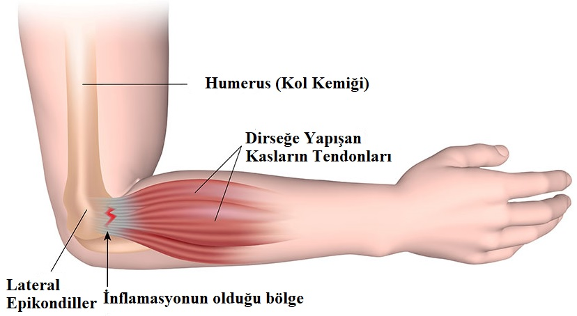
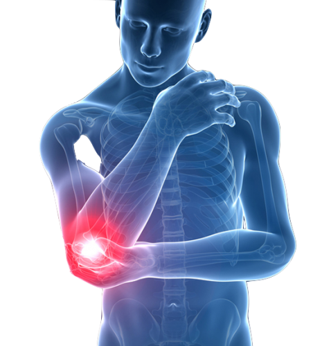
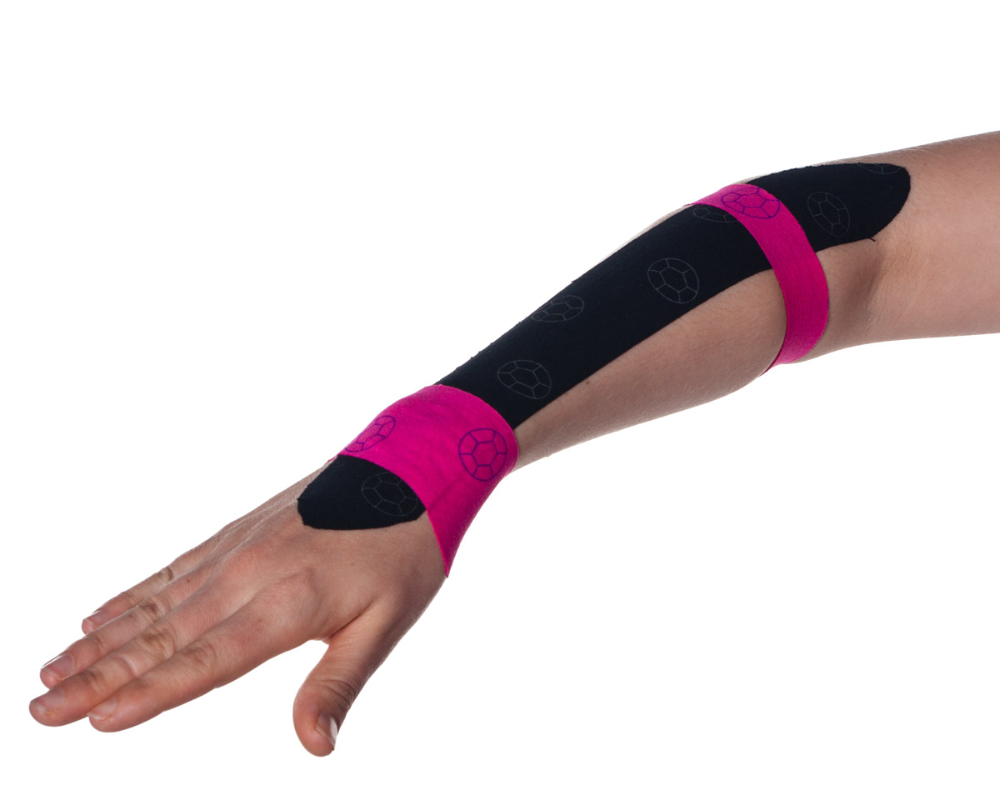
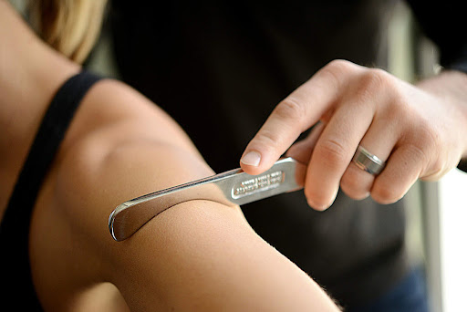

**Tenisçi dirseği**, dirseğin dış kenarında yoğun ve noktasal hissedilen ağrı ile karakterize edilen, genelde tendonların iltihaplanmasına bağlı bir rahatsızlıktır. Bu sorunla karşılaşanların çoğu “Ben tenis oynamıyorum, nereden çıktı bu şimdi?” diye şaşırır; çünkü problem sadece tenisçilere özgü değildir.

## Neden Olur?

El bileğini kolun dış yüzüne doğru bükmeyi sağlayan kaslar, dirseğin dış tarafındaki **lateral epikondil** adlı kemik çıkıntıya tendonlarla tutunur. Bu kaslar tekrarlı ve zorlayıcı kuvvetlere maruz kaldığında zayıflar; tendon üzerindeki yük artar ve tendon strese girer. Tendonun yapıştığı lateral epikondilde hasar oluşur ve burada bir iltihaplanma (tendinit) gelişir.

Bu zincirleme reaksiyonun sonucu olarak:

- Lateral epikondilde iltihaplanma meydana gelir.
- Ağrı nedeniyle kişi kolu kullanmaktan çekinir.
- Kaslar kullanılmayınca daha da zayıflar ve hacim kaybeder.
- En küçük aktivitede bile zorlanma başlar.
- Tendon üzerindeki yük daha da artar ve kronikleşme riski olur.

## Kimlerde Daha Sık Görülür?

Tenis oynayanlarda görülebilir fakat günlük hayatta tekrarlı kol/elde zorlayıcı hareket yapan kişilerde daha sık kronikleşir. Örnekler:

- Temizlik yapan, sürekli ağır yük taşıyan ev işleri yapan kişiler,
- Market poşeti taşıyanlar,
- Hastasına yardımcı olmaya çalışan kişiler,
- Tekrar tekrar çekici kullanan fabrika işçileri.

Bu tür tekrar eden aktiviteler lateral epikondilin iltihaplanmasına ve aylarca, hatta yıllarca sürebilecek kronik bir probleme dönüşmesine neden olabilir.

## Tedavi Yöntemleri

Tenisçi dirseği tedavisinde yaygın olarak kullanılan yaklaşımlar şunlardır:

- **Friksiyon masajı**
- **Graston masajı**
- **Elektroterapi modaliteleri**
- **ESWT (şok dalga tedavisi)**
- **Kinezyolojik bantlama**
- **Klinik egzersiz (özellikle kuvvetlendirme ve dayanıklılık çalışmaları)**
- **Manuel terapi**

> Not: Masaj, elektroterapi vb. uygulamalar **egzersiz programı ile desteklenmediği sürece** genellikle yalnızca geçici rahatlama sağlar. İltihabın tekrarlamaması için kol ve el bileği kaslarının kuvvetlendirilmesi ve dayanıklılıklarının artırılması gereklidir.
